# CleanTicket | 티켓팅 서비스 보안 관제

> 공연 예매 서비스를 대상으로 매크로 예매, 비인가 접근, 웹 공격과 대량 트래픽을 탐지·대응하는 팀 프로젝트입니다. 저는 팀장으로 작업을 조율하고 **Snort IDS/IPS 규칙 작성과 Graylog 서버 구축·로그 연동**을 맡았습니다.

| 항목 | 내용 |
| --- | --- |
| 기간 | 2026.06.01–06.22 |
| 팀 | 이스트캠프 가디언즈 2차 프로젝트 · 5조 KALI KALI (5명) |
| 프로젝트명 | CleanTicket · 결과보고서의 프로젝트 개요에는 Anti-Kali로도 표기 |
| 담당 | 문경구 · 팀장, IDS/IPS 탐지·차단 규칙, Graylog 서버 구축·연동 및 로그 확인 |
| 형태 | 가상 실습 환경의 티켓팅 웹서비스와 보안 인프라 |

## 프로젝트 목표와 구조

공연 티켓 판매가 시작되면 짧은 시간에 접속이 몰립니다. 이 환경에서 정상 예매를 유지하면서 포트 스캔, 관리자 경로 접근, 매크로 예약, SYN Flood 같은 비정상 트래픽을 확인하는 것이 목표였습니다. 팀은 티켓팅 웹·DB, pfSense, Snort, Graylog, GoAccess와 PMM을 연결했습니다.

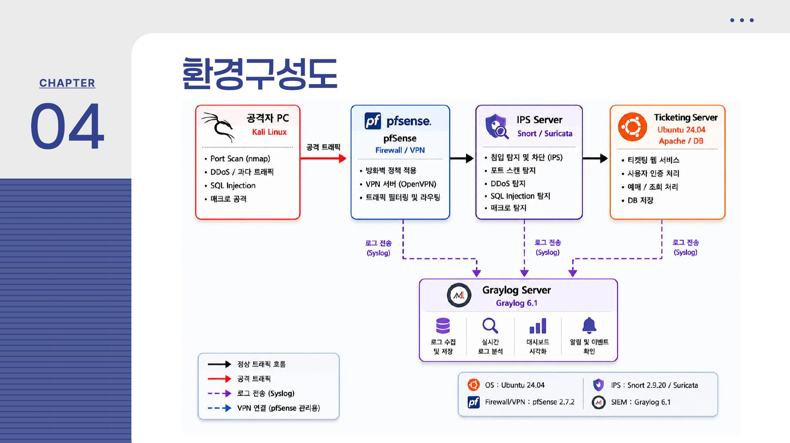
2차 프로젝트 계획서 6쪽의 설계도. 공격 트래픽은 pfSense와 IPS를 지나 웹서비스에 도달하고, 보안 이벤트는 Graylog로 모으는 구상입니다.

결과보고서에서는 pfSense 관리망과 내부 VLAN, 보안 영역, 웹 영역을 나눠 표시했습니다. 이 그림은 팀의 최종 네트워크 설명 자료입니다. pfSense·VPN·웹 페이지 구현까지 제가 단독으로 맡은 것은 아닙니다.

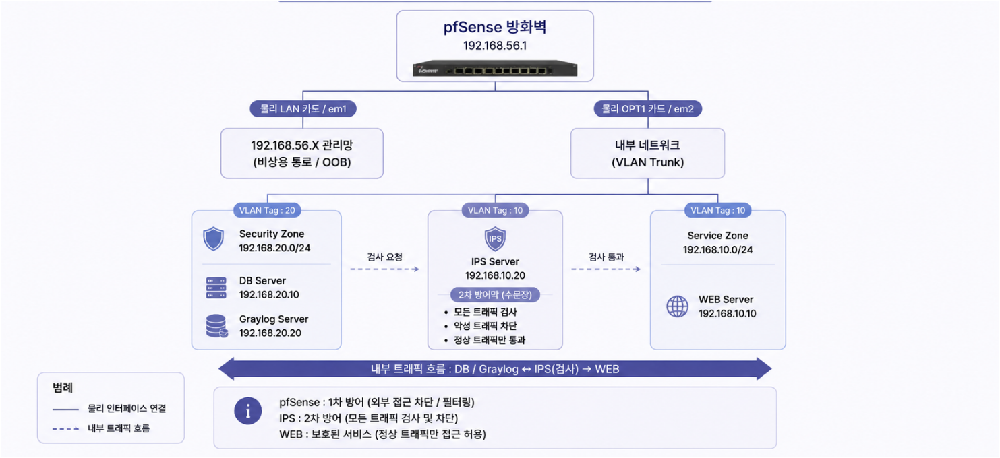
2차 결과보고서 7쪽의 토폴로지. 서비스 영역과 보안 영역을 나누고 IPS 검사를 거치는 흐름을 보여줍니다.

| 영역 | 팀의 구성 | 담당 구분 |
| --- | --- | --- |
| 티켓팅 웹·DB | 예매 화면, 예약 처리, MariaDB | 웹·시스템 구축 팀원 |
| 네트워크 경계 | pfSense, VLAN 정책, OpenVPN | 방화벽·VPN 담당 팀원 |
| 침입 탐지·차단 | Snort IDS/IPS 규칙 | **내 담당** |
| 로그 관제 | Snort 경보 전달, Graylog 검색·시각화 | **내 담당** |
| 운영 지표 | GoAccess 웹 접속 분석, PMM DB 상태 | 팀의 모니터링 구성 |
| Linux 점검 | KISA 기준 Shell Script | 스크립트 담당 팀원 |

## 내가 맡은 작업

### 1. IDS/IPS 규칙 작성

Snort가 검사할 내부망과 웹 서버 범위를 설정하고, 공격을 **기록하는 `alert` 규칙**과 패킷 차단을 의도한 **`drop` 규칙**을 나눠 작성했습니다. 노션에는 Snort 설정 파일의 `HOME_NET`, `EXTERNAL_NET`, `HTTP_SERVERS`, HTTP 포트를 환경에 맞추는 절차와 SID별 규칙 초안이 남아 있습니다.

| 규칙 유형 | 대표 SID | 검사한 징후 |
| --- | --- | --- |
| IDS 경보 | `1000001`–`1000004` | 짧은 시간의 포트 스캔, 관리자 URL 접근, 시스템 파일 경로 탐색, Nikto User-Agent |
| IPS 차단 규칙 | `1000101`, `1000103` | SYN 패킷 급증, 예매 처리 경로의 반복 요청 |
| IPS 차단 규칙 | `1000105`, `1000108`, `1000110` | 결제 값 변조 패턴, XSS 문자열, HeadlessChrome 헤더 |

특히 매크로 규칙은 **실제 예매 처리 URL과 맞아야** 합니다. 노션 초안에는 `/ticket/reserve`를 대상으로 한 예시가 있지만, 결과보고서의 규칙 캡처에는 실제 서비스 경로인 `/reserve_process.php`가 들어 있습니다. 두 자료의 요청 횟수 임계값도 다르므로 하나의 최종 설정값으로 합쳐 쓰지 않았습니다.

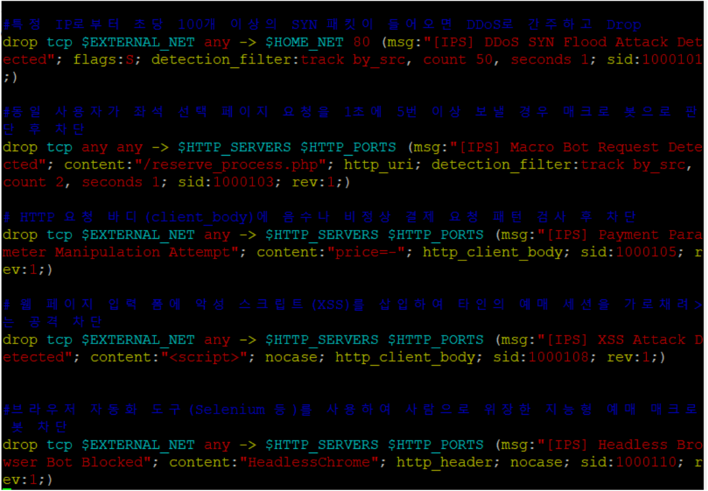
2차 결과보고서 21쪽. SYN Flood, 예매 매크로, 결제 값 변조, XSS, HeadlessChrome 패턴에 대한 `drop` 규칙입니다. 주석과 실제 규칙의 임계값이 서로 다른 부분은 코드에 적힌 값과 구분해 읽었습니다.

### 2. Graylog 서버와 Snort 경보 연동

Graylog 서버를 구축하고 Snort 경보가 중앙 관제 화면에 도달하도록 연동했습니다. Snort의 `alert_syslog` 출력을 설정하고, rsyslog가 `snort` 프로그램의 경보를 Graylog 입력으로 전달하도록 구성 절차를 정리했습니다. 노션에는 `snort -T` 문법 검사와 Snort·rsyslog 서비스 재시작 순서가 있습니다. 결과보고서의 Graylog 화면에는 `ipsserver`가 보낸 SID·시각·출발지·목적지 정보가 표시돼, **규칙 경보가 중앙 로그까지 도달한 것**을 확인할 수 있습니다.

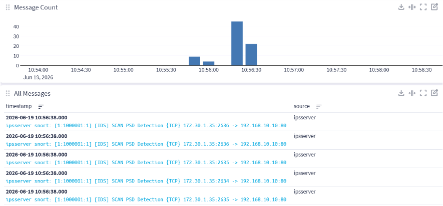
2차 결과보고서 17쪽. `SID 1000001`의 `SCAN PSD Detection` 경보가 시간대별 건수와 개별 이벤트로 나타납니다.

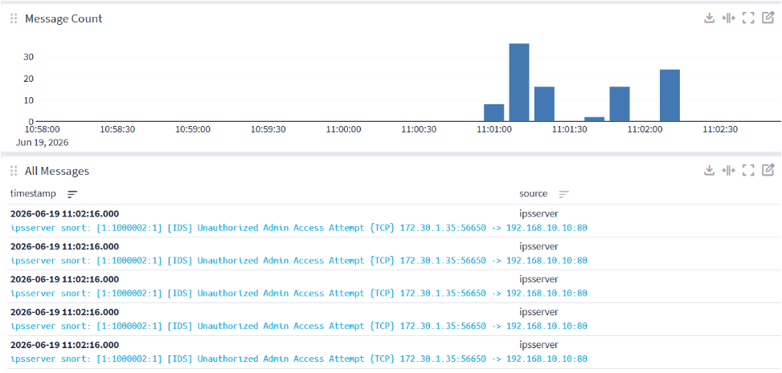
2차 결과보고서 18쪽. `SID 1000002`의 `Unauthorized Admin Access Attempt` 이벤트입니다. 로그 수집은 확인되지만 이 화면만으로 접근 차단까지 입증되지는 않습니다.

### 3. 팀 일정과 시연 항목 조율

팀장으로 보안 관제와 웹·네트워크 담당자의 연결 지점을 맞췄습니다. 6월 9일 회의록에는 웹과 로그 서버 분리, IDS/IPS–Graylog 연동, 서버 간 연결 확인이 남아 있습니다. 6월 15일 회의록에는 웹 예매 시연과 IDS/IPS 경보 시연을 나눠 준비하고 SYN Flood 등 공격 화면을 확보하는 계획이 적혀 있습니다. 회의록의 예정 항목은 아래 결과보고서에 실제로 남은 화면과 구분했습니다.

## 공격 시나리오와 확인 결과

### 매크로 예매: 요청 성공과 IPS 경보를 함께 확인

팀의 Python 시연 프로그램은 짧은 간격으로 좌석을 바꿔 예매 요청을 보냈습니다. 결과보고서에는 **연속 요청 7건이 HTTP 200으로 응답**하고, MariaDB 예약 테이블에 **7건이 저장된 화면**이 있습니다. 이는 대응 전 비정상 자동 예매가 가능했던 근거입니다. 프로그램 작성과 예매 웹 구현은 팀 전체의 시연 작업으로 기록했습니다.

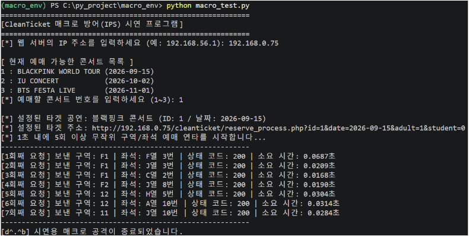
2차 결과보고서 15쪽의 요청 실행 화면. 매크로 요청이 웹 애플리케이션에 도달한 상태를 보여줍니다.

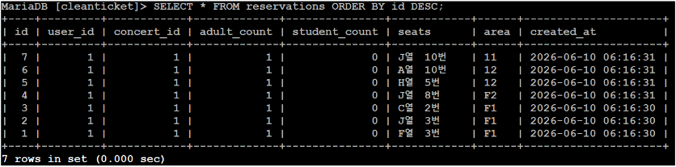
같은 쪽의 DB 조회 화면. 시연 당시 자동 요청으로 예약 레코드가 생성됐다는 근거입니다.

IPS 관련 결과 화면에는 `SID 1000103`의 `Macro Bot Blocked Immediately` 경보가 Graylog에 수집됐습니다. `SID 1000110`의 Headless Browser 경보도 별도 화면에 남아 있습니다. **경보 발생은 확인되지만**, 위의 HTTP 200 요청과 같은 시점의 패킷이 실제로 드롭됐는지, 차단 후 예약 성공률이 얼마였는지는 보고서만으로 측정할 수 없습니다.

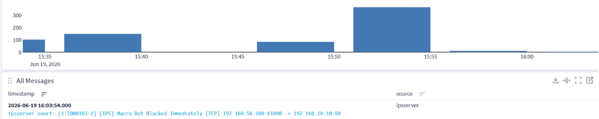
2차 결과보고서 23쪽. `Macro Bot Blocked Immediately` 로그가 중앙 관제에 들어온 장면입니다.

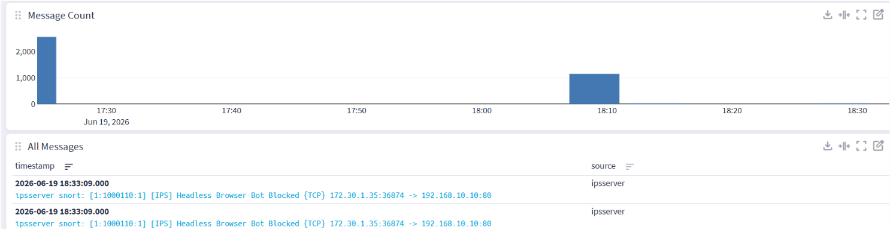
2차 결과보고서 24쪽. 브라우저 자동화 도구의 헤더 패턴을 대상으로 한 `SID 1000110` 경보입니다.

### SYN Flood: PMM으로 부하 변화를 관찰

팀은 SYN Flood 시나리오에서 웹·DB 측 부하 변화를 PMM으로 살폈습니다. 결과보고서는 공격 후 부하 증가와 서비스 장애를 평가합니다. 첨부된 PMM 캡처에서는 **Load Average가 0.00에서 1.11로 달라진 장면**을 볼 수 있습니다. 이 수치는 두 화면의 관찰값이며 장기 가용성이나 방어 성능을 나타내는 지표로 확대하지 않았습니다.

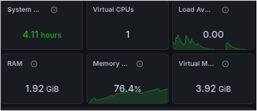
2차 결과보고서 14쪽의 공격 전 시스템 지표.

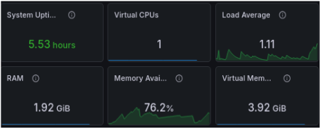
같은 쪽의 공격 후 지표. 측정 시각과 부하 조건을 통제한 반복 시험 자료는 보고서에 없습니다.

## 작업에서 배운 점과 개선 과제

- **규칙은 서비스 경로와 함께 바뀝니다.** 매크로 규칙 초안과 보고서 캡처의 URL·임계값이 달랐습니다. 규칙 파일, 실제 요청 경로, 로그의 SID를 같은 버전으로 묶어 관리해야 재현이 쉽습니다.
- **탐지와 차단의 근거를 구분했습니다.** Graylog는 Snort 이벤트가 수집됐다는 근거입니다. 차단 성공을 입증하려면 같은 요청의 응답·서버 로그·예약 DB 변화를 함께 확인해야 합니다.
- **임계값은 정상 티켓팅 부하와 비교해야 합니다.** 짧은 시간의 반복 요청만으로 매크로를 분류하면 예매 시작 시 정상 이용자도 영향을 받을 수 있습니다. 오탐률과 실제 차단율의 반복 측정은 후속 과제입니다.

결과보고서에는 더 다양한 공격 패턴과 방어 자동화 로직을 시험하지 못한 한계가 적혀 있습니다. 웹·방화벽·Shell Script의 팀 성과를 제 개인 구현 성과로 적지 않았습니다.

**내 담당 기술:** `Snort` · `IDS/IPS` · `rsyslog` · `Graylog` · `Linux`

**팀 전체 기술:** `pfSense` · `OpenVPN` · `Ubuntu` · `Apache/PHP` · `MariaDB` · `GoAccess` · `PMM` · `Shell Script`

### 자료 기준

- [2차 프로젝트 계획서.pdf](https://drive.google.com/file/d/1-tpr7ElANz7eYZCcRDXxRz6exSLWsErW/view): 목표·설계 아키텍처·역할과 일정. 설계 이미지는 6쪽에서 가져왔습니다.
- [2차프로젝트 결과보고서.pptx](https://docs.google.com/presentation/d/1XWuicFd1WodjMHjVa9i2DN1BY4hdF3r7/edit): 최종 역할, 네트워크, 공격 시연, IDS/IPS 규칙과 Graylog 화면. 나머지 이미지는 관련 슬라이드에서 추출했습니다.
- [팀 KALI KALI 노션](https://app.notion.com/p/oreumi/team5-KALI-KALI-352ebaa8982b807f8f37d18e1f012b84): 회의록·공격 시나리오와 작업 데이터베이스. [IDS/IPS 설정](https://app.notion.com/p/oreumi/IDS-IPS-376ebaa8982b8041bb78e2b613274b55), [Graylog 연동 설정](https://app.notion.com/p/oreumi/Graylog-379ebaa8982b805db188d1dda8f48b43), [테스트 자료](https://app.notion.com/p/oreumi/IPS-IDS-384ebaa8982b80669d12ff48819eb77e)를 대조했습니다.

계획서의 목표, 노션의 작업 절차, 결과보고서의 실제 화면을 구분해 작성했습니다. 공개 문서와 이미지에는 노션의 세션 쿠키·계정 정보·인증값을 옮기지 않았습니다.
